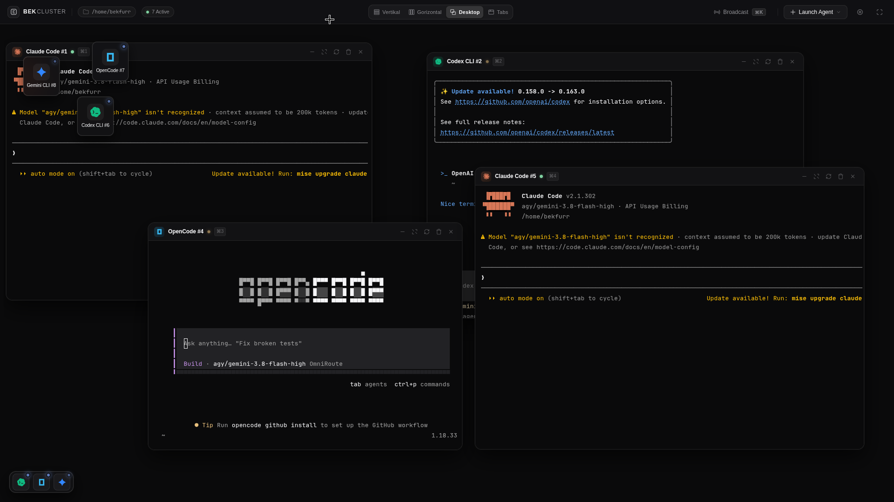
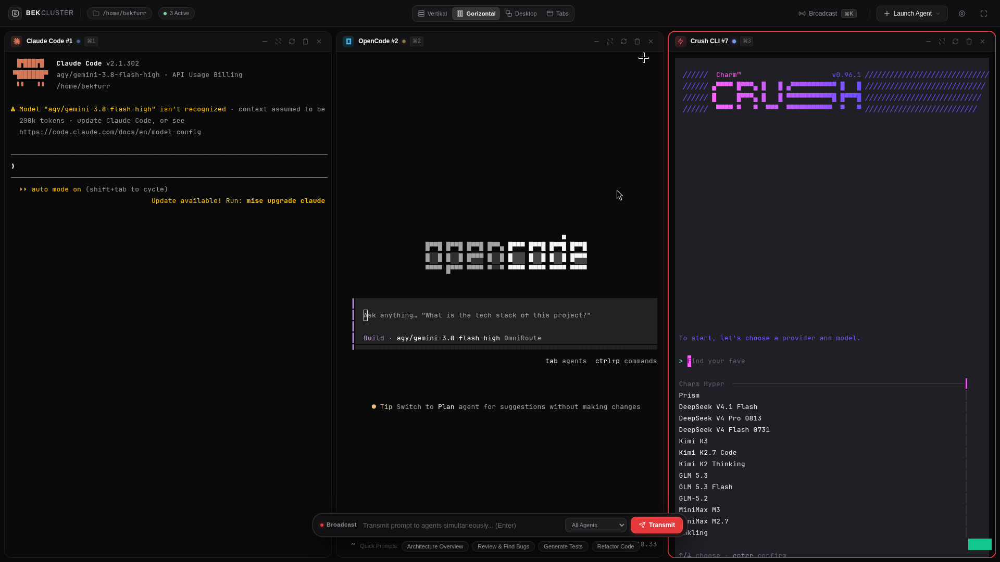

# BEKFURR AGENT CLUSTER (`bek-cluster`)

> Multi-Agent AI Terminal Orchestrator & Virtual Workspace  
> Run and orchestrate multiple CLI AI agents (Claude Code, Antigravity CLI, OpenAI Codex, OpenCode, Copilot, etc.) simultaneously in an Apple visionOS / macOS inspired web environment.

---


---

## Overview

**BEKFURR AGENT CLUSTER** is a minimalist, local developer workspace designed for running, comparing, and broadcasting commands across multiple AI coding agents side-by-side.

Instead of managing cluttered tmux panes or detached terminal windows, `bek-cluster` unifies your command-line workflow inside a dark, hardware-accelerated web terminal interface.

### Highlights

- **Auto-Detection**: Scans your system environment and provides one-click launching for detected tools (`claude`, `agy`, `codex`, `opencode`, `copilot`, `crush`, `pi`, `bash`, or custom binaries).
- **Simultaneous Multi-Agent Execution**: Run multiple independent agent sessions in parallel on the same project repository.
- **Working Directory Switcher & Safety Restart**: View each agent's active folder path directly in the pane header. Click to re-target the agent to a different directory with instant process re-spawning and safety confirmation.
- **Token & Model Usage Analytics**: Real-time stream sniffing for token consumption (prompt, completion, total) and AI model tracking with visionOS-styled breakdown KPIs, progress bars, and historical logs.
- **Spotlight Broadcast Bar**: Floating capsule (`Cmd/Ctrl + K`) allowing you to transmit a prompt to all active agents simultaneously for benchmark comparison or collaborative work.
- **Dynamic Layout Engine**:
  - **Vertikal**: Displays up to 3 agents vertically with smooth wheel / arrow navigation.
  - **Gorizontal**: Displays up to 3 agents side-by-side with mouse wheel horizontal translation.
  - **Virtual Desktop**: Drag, float, and pinch-resize terminal windows in freeform 2D space.
  - **Tabs**: Fullscreen single-agent tab switching.
- **Background Execution & Minimize to Dock**: Collapse any active pane into a compact status icon with the `-` control. Background PTY processes continue executing without interruption.
- **4-Color Real-Time Status Engine**:
  - Yellow: Thinking / processing stream
  - Green: Done / ready / idle
  - Red: Error / non-zero exit
  - Blue: Waiting for user confirmation or interactive input
- **xterm.js + node-pty**: TrueColor, desaturated ANSI palette, cursor blink, resize handling, mouse interactions, and hyperlink support.

---

## Interface Previews

Place your workspace screenshots in `docs/screenshots/`:

| Overview (Desktop Mode) | Spotlight Broadcast & Dynamic Flow |
| :---: | :---: |
|  |  |

---

## Installation & Setup

### 1. Install dependencies
```bash
cd /home/bekfurr/BEK-CLUSTER
npm install
```

### 2. Link as a global CLI command
```bash
# Option A (npm link):
npm link

# Option B (global install from local directory):
npm install -g .
```

### 3. Launch from any project folder
```bash
cd /path/to/any/project
bek-cluster
```
Your default browser will launch at `http://127.0.0.1:3888` pointing all agents to your current project directory.

---

## CLI Usage & Flags

```text
Usage: bek-cluster [options]

BEKFURR-AGENT-CLUSTER: Multi-Agent AI Terminal Orchestrator

Options:
  -v, --version           Show current version
  -p, --port <number>     Server port (default: 3888; auto-increments if busy)
  -H, --host <host>       Host to bind (default: 127.0.0.1)
  -d, --dir <path>        Workspace directory for agents (default: current directory)
  --no-open               Do not open default browser automatically
  -h, --help              Display help information
```

### Examples

```bash
# Standard launch:
bek-cluster

# Run on a custom port:
bek-cluster -p 4200

# Open targeted project repository:
bek-cluster -d ~/projects/my-web-app

# Headless server mode (e.g. over SSH port-forwarding):
bek-cluster --no-open
```

---

## Keyboard Shortcuts

- `Cmd/Ctrl + K`: Toggle floating Spotlight broadcast capsule and focus input
- `Cmd/Ctrl + 1..6`: Quickly switch focus to window 1 through 6
- `Arrow Keys` (or `Alt + Arrow`): Smoothly scroll between agents in Vertikal or Gorizontal modes
- `Mouse Wheel`: Automatically converted to horizontal scrolling in Gorizontal layout
- `Escape`: Close menus and popover modals

---

## Supported Agents

| Agent | Executable | Description |
|---|---|---|
| **Claude Code** | `claude` | Anthropic official CLI coding agent |
| **Antigravity** | `antigravity` | Google DeepMind agentic coding system |
| **Codex CLI** | `codex` | OpenAI terminal assistant |
| **OpenCode** | `opencode` | Autonomous open-source AI software engineer |
| **Antigravity CLI** | `agy` | Google DeepMind Antigravity CLI coding assistant |
| **GitHub Copilot** | `copilot` | GitHub Copilot CLI |
| **Crush CLI** | `crush` | Terminal code assistant |
| **Pi CLI** | `pi` | Personal AI assistant |
| **Bash Terminal** | `bash` | Standard system shell session |
| **Custom Binary** | *custom* | Any command, interpreter, or flags |

---

## Architecture

- **Backend**: Node.js, Express, WebSocket (`ws`), `node-pty` pseudo-terminal manager.
- **Frontend**: Vanilla ES6+, `xterm.js`, `xterm-addon-fit`, `xterm-addon-web-links`, CSS visionOS Glassmorphism design system.
- **Window Management**: Custom virtual desktop manager supporting freeform dragging, 8-way directional resize handles, z-index elevation, and persistent background execution via CSS minimization.

---

## License

MIT License © 2026 bekfurr
